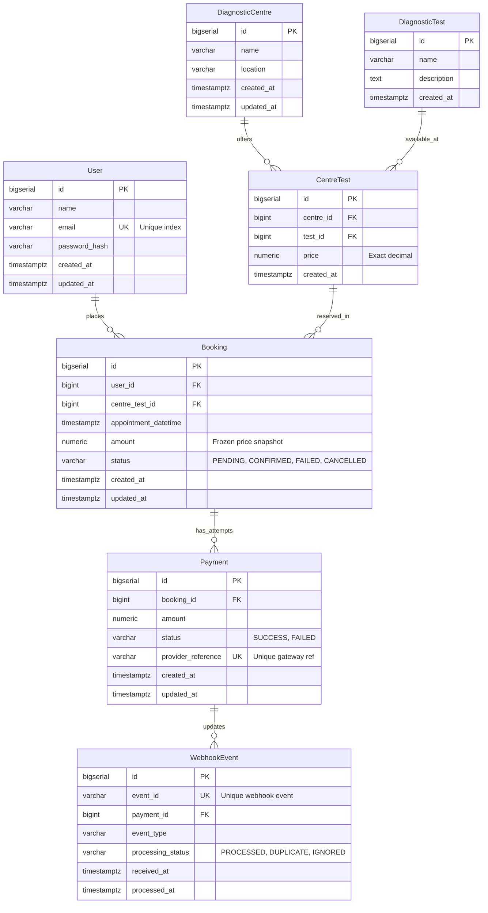

# EVE Healthcare — Diagnostic Test Booking & Payment Backend

A production-grade, modular backend service built with **Java 21**, **Spring Boot 3.3**, and **PostgreSQL** for diagnostic test bookings, pricing catalogues, and simulated payment processing with database-level webhook idempotency.

---

## Table of Contents
1. [Project Overview & Scope](#project-overview--scope)
2. [Tech Stack](#tech-stack)
3. [Architecture & Module Responsibilities](#architecture--module-responsibilities)
4. [Database Schema & Relationships](#database-schema--relationships)
5. [Booking & Payment State Lifecycle](#booking--payment-state-lifecycle)
6. [Webhook Idempotency & Concurrency Strategy](#webhook-idempotency--concurrency-strategy)
7. [Authentication & Security Flow](#authentication--security-flow)
8. [API Documentation & Sample Requests](#api-documentation--sample-requests)
9. [Setup & Execution Instructions](#setup--execution-instructions)
10. [Automated Testing Strategy](#automated-testing-strategy)
11. [Engineering Decisions & Technical Defense](#engineering-decisions--technical-defense)
12. [Interview Preparation Guide (Q&A)](#interview-preparation-guide-qa)
13. [Assumptions, Trade-Offs & Production Roadmaps](#assumptions-trade-offs--production-roadmaps)

---

## Project Overview & Scope
The EVE Healthcare platform enables patients to discover diagnostic testing centres, view available lab tests with location-specific pricing, book appointments, and initiate payments. It also simulates asynchronous payment webhook callbacks from payment gateways (e.g., Stripe, Razorpay) with strict at-least-once delivery guarantees and idempotency protection.

### Core Capabilities
- **JWT Authentication**: User registration and login with BCrypt password hashing and stateless token issuance.
- **Diagnostic Catalogue**: Hierarchical centres and tests with Many-to-Many pricing relationships (`CentreTest`).
- **Booking Engine**: Immutable price snapshots at reservation time, appointment validation, and strict user isolation.
- **Simulated Payment Engine**: Thread-safe payments utilizing database pessimistic write locks (`PESSIMISTIC_WRITE`).
- **Idempotent Webhook Processor**: Database unique constraint enforcement (`uq_webhook_event_id`) handling duplicated and concurrent webhook events without redundant state mutations or double charges.

---

## Tech Stack
| Component | Technology | Rationale |
|---|---|---|
| **Language** | Java 21 (LTS) | Modern Java features (pattern matching, records, virtual threads capability) |
| **Framework** | Spring Boot 3.3.4 | Mature dependency injection, Spring Web MVC, Spring Security 6 |
| **Data Persistence** | Spring Data JPA / Hibernate 6 | ORM with explicit fetch plans to prevent N+1 query overhead |
| **Database** | PostgreSQL 16 / H2 (in-memory test) | Relational integrity, ACID transactions, row-level locks, unique constraints |
| **Database Migrations** | Flyway | Versioned, repeatable, SQL-first database schema evolutions |
| **Security & JWT** | Spring Security + JJWT 0.12.6 | Stateless HMAC-SHA256 signature verification & RBAC context |
| **Testing** | JUnit 5 + MockMvc + AssertJ | Comprehensive integration and concurrency testing suite |
| **Documentation** | SpringDoc OpenAPI 2.6 (Swagger UI) | Interactive API exploration and OpenAPI 3.0 contract definition |
| **Containerization** | Docker & Docker Compose | Multi-stage lightweight Alpine images with healthcheck orchestration |

---

## Architecture & Module Responsibilities
The project follows a **Modular Monolith** structure with strict separation of concerns:

```
src/main/java/com/eve/healthcare/
├── EveHealthcareApplication.java      # Application entrypoint
├── common/                            # Shared cross-cutting concerns
│   ├── config/                        # SecurityConfig, OpenApiConfig
│   ├── exception/                     # GlobalExceptionHandler, Custom Exceptions, ErrorResponse
│   └── security/                      # JwtService, JwtAuthenticationFilter, CustomUserDetails, SecurityUtils
├── domain/                            # Core domain models & business logic
│   ├── model/                         # JPA Entities (User, Centre, Test, CentreTest, Booking, Payment, WebhookEvent)
│   ├── repository/                    # Spring Data Repositories with custom JPQL fetch & locking
│   └── service/                       # AuthService, CentreService, BookingService, PaymentService, WebhookService
└── web/                               # HTTP Presentation Layer
    ├── controller/                    # AuthController, CentreController, TestController, BookingController, PaymentController
    └── dto/                           # Immutable Request & Response payloads (with Bean Validation)
```

- **Controllers**: Handle HTTP serialization, parameter extraction, and status code mapping.
- **DTOs**: Enforce input validation (`@Email`, `@NotBlank`, `@Future`, `@Positive`) and decouple database models from external clients.
- **Services**: Encapsulate transaction boundaries (`@Transactional`), business rules, and state transitions.
- **Repositories**: Encapsulate data access with JOIN FETCH queries to eliminate N+1 queries.
- **GlobalExceptionHandler**: Uniform error contract across the entire application without leaking internal stack traces or database driver details.

---

## Database Schema & Relationships



### Key Relational Decisions:
1. **CentreTest as a First-Class Junction Entity**: Diagnostic tests have different prices across different centres. Storing price in `CentreTest` allows independent pricing per centre with a composite unique constraint `(centre_id, test_id)`.
2. **Numeric Precision**: Prices and amounts use `NUMERIC(10, 2)` (mapped to Java `BigDecimal`), avoiding floating-point inaccuracies.
3. **Auditability**: Timestamps (`created_at`, `updated_at`) are stored with time zones (`TIMESTAMP WITH TIME ZONE`).

---

## Booking & Payment State Lifecycle

```
================ BOOKING STATE TRANSITION GRAPH ================

                 ┌───────────────────────────┐
                 │          PENDING          │
                 └─────────────┬─────────────┘
                               │
            ┌──────────────────┼──────────────────┐
            │                  │                  │
    [Payment Succeeded]   [User Cancels]   [Payment Fails]
            │                  │                  │
            ▼                  ▼                  ▼
      ┌───────────┐      ┌───────────┐      ┌───────────┐
      │ CONFIRMED │      │ CANCELLED │◄─────┤  FAILED   │
      └───────────┘      └───────────┘      └─────┬─────┘
       (Terminal)         (Terminal)              │
                                                  │ [User Retries Payment]
                                                  ▼
                                            ┌───────────┐
                                            │ CONFIRMED │
                                            └───────────┘
```

### Invariant Rules:
1. **Booking Creation**: Created strictly with `status = PENDING`.
2. **Price Snapshotting**: The `Booking.amount` is frozen at creation time from `CentreTest.price`. Even if the diagnostic centre alters its pricing later, the booking price is immutable.
3. **Terminal States**:
   - `CONFIRMED`: A booking for which payment has succeeded. Cannot be cancelled (`409 Conflict`).
   - `CANCELLED`: Terminal. Cannot receive payments (`409 Conflict`).
4. **Retry Semantics**: If a payment attempt fails, the booking transitions to `FAILED`. A new payment attempt can be initiated for a `FAILED` booking, creating a new `Payment` record and transitioning the booking to `CONFIRMED` upon success.

---

## Webhook Idempotency & Concurrency Strategy

Payment gateways operate under an **at-least-once delivery model**, meaning network retries, timeouts, or gateway re-deliveries will send the same webhook event multiple times.

```
Webhook Request (event_id, payment_id, status)
                      │
                      ▼
       [Check existsByEventId in DB]
             /                 \
       (Found: Yes)        (Found: No)
           /                     \
          ▼                       ▼
  Return 200 OK             Begin Transaction
  {"status":"duplicate"}          │
                                  ▼
                         [Check Payment State]
                                  │
                  ┌───────────────┴───────────────┐
                  │                               │
         (Payment is SUCCESS)             (Payment is FAILED)
                  │                               │
                  ▼                               ▼
          No State Downgrade              Upgrade to SUCCESS
          Save Event: IGNORED             Update Booking: CONFIRMED
          Return 200 OK                   Save Event: PROCESSED
                                          Return 200 OK
```

### Idempotency Guarantees:
1. **Database-Level Unique Constraint**: `webhook_events.event_id` has a unique constraint in PostgreSQL.
2. **Concurrent Webhook Deliveries**: When two identical webhook requests hit the server at the exact same millisecond:
   - Both proceed into the transaction.
   - The first thread commits the event insertion.
   - The second thread encounters a `DataIntegrityViolationException` from the PostgreSQL unique index.
   - The exception is caught cleanly, rolling back the duplicate attempt and returning an idempotent `200 OK {"status": "duplicate"}` response.
3. **No-Downgrade Invariant**: If a `SUCCESS` payment has already been completed, an out-of-order or late `FAILED` webhook event is recorded as `IGNORED` and does **not** downgrade the payment or booking.

---

## Authentication & Security Flow

```
Client                             AuthController                    JwtService
  │                                      │                               │
  │─── POST /auth/signup/ or /login/ ───▶│                               │
  │                                      │── Verify / Hash BCrypt ───────│
  │                                      │── Issue JWT (sub=userId) ────▶│
  │◀── 200/201 + access_token ───────────│                               │
  │                                                                      │
  │─── GET /bookings/ (Bearer <token>) ──────────────────────────────────┼──┐
                                                                            │
                       [JwtAuthenticationFilter] ◀──────────────────────────┘
                                │
                       Extract Bearer token
                       Verify HMAC signature & expiration
                       Populate SecurityContext (userId principal)
                                │
                                ▼
                       Execute Protected Controller
```

- **Password Hashing**: BCrypt with adaptive cost factor (passwords never stored in plaintext).
- **Stateless Authorization**: `JwtAuthenticationFilter` executes on each request, populating Spring's `SecurityContext`.
- **Privacy Enforcement**: Endpoints accessing user bookings strictly filter by the authenticated user's ID. Unauthorized attempts to view or cancel another user's booking return `404 Not Found` (rather than `403 Forbidden`) to avoid leaking resource existence.

---

## API Documentation & Sample Requests

Interactive Swagger UI documentation is available at:
`http://localhost:8080/swagger-ui.html`

### 1. Authentication

#### User Signup
- **Method**: `POST`
- **Path**: `/auth/signup/`
- **Request Body**:
```json
{
  "name": "Priyanshi",
  "email": "priyanshi@example.com",
  "password": "securepassword123"
}
```
- **Response** (`201 Created`):
```json
{
  "user": {
    "id": 1,
    "name": "Priyanshi",
    "email": "priyanshi@example.com",
    "created_at": "2026-09-29T19:30:00Z"
  },
  "access_token": "eyJhbGciOiJIUzI1NiJ9...",
  "token_type": "bearer"
}
```

#### User Login
- **Method**: `POST`
- **Path**: `/auth/login/`
- **Request Body**:
```json
{
  "email": "priyanshi@example.com",
  "password": "securepassword123"
}
```
- **Response** (`200 OK`):
```json
{
  "user": {
    "id": 1,
    "name": "Priyanshi",
    "email": "priyanshi@example.com",
    "created_at": "2026-09-29T19:30:00Z"
  },
  "access_token": "eyJhbGciOiJIUzI1NiJ9...",
  "token_type": "bearer"
}
```

---

### 2. Centres & Tests Catalogue

#### List All Centres
- **Method**: `GET`
- **Path**: `/centres/`
- **Response** (`200 OK`):
```json
[
  {
    "id": 1,
    "name": "HealthFirst Diagnostics",
    "location": "Mumbai, Maharashtra",
    "created_at": "2026-09-29T19:00:00Z"
  },
  {
    "id": 2,
    "name": "MedLab Plus",
    "location": "Delhi, NCR",
    "created_at": "2026-09-29T19:00:00Z"
  }
]
```

#### Get Centre with Test Offerings & Prices
- **Method**: `GET`
- **Path**: `/centres/1/`
- **Response** (`200 OK`):
```json
{
  "id": 1,
  "name": "HealthFirst Diagnostics",
  "location": "Mumbai, Maharashtra",
  "created_at": "2026-09-29T19:00:00Z",
  "tests": [
    {
      "id": 1,
      "test_id": 1,
      "test_name": "Complete Blood Count (CBC)",
      "price": 500.00
    },
    {
      "id": 2,
      "test_id": 2,
      "test_name": "Lipid Profile",
      "price": 800.00
    }
  ]
}
```

#### List All Tests (with optional pagination: `?page=0&size=20`)
- **Method**: `GET`
- **Path**: `/tests/`
- **Response** (`200 OK`):
```json
[
  {
    "id": 1,
    "name": "Complete Blood Count (CBC)",
    "description": "Measures blood components including RBC, WBC, and platelets",
    "created_at": "2026-09-29T19:00:00Z"
  }
]
```

#### Create a Diagnostic Centre (Management Endpoint)
- **Method**: `POST`
- **Path**: `/centres/`
- **Headers**: `Authorization: Bearer <access_token>`
- **Request Body**:
```json
{
  "name": "Apex Diagnostics",
  "location": "Hyderabad, Telangana"
}
```
- **Response** (`201 Created`):
```json
{
  "id": 4,
  "name": "Apex Diagnostics",
  "location": "Hyderabad, Telangana",
  "created_at": "2026-09-29T19:40:00Z"
}
```

#### Create a Diagnostic Test (Management Endpoint)
- **Method**: `POST`
- **Path**: `/tests/`
- **Headers**: `Authorization: Bearer <access_token>`
- **Request Body**:
```json
{
  "name": "Vitamin D Test",
  "description": "Assesses 25-hydroxy vitamin D levels"
}
```
- **Response** (`201 Created`):
```json
{
  "id": 6,
  "name": "Vitamin D Test",
  "description": "Assesses 25-hydroxy vitamin D levels",
  "created_at": "2026-09-29T19:40:00Z"
}
```

#### Add a Test to a Centre with Price (Management Endpoint)
- **Method**: `POST`
- **Path**: `/centres/1/tests/`
- **Headers**: `Authorization: Bearer <access_token>`
- **Request Body**:
```json
{
  "test_id": 5,
  "price": 850.00
}
```
- **Response** (`201 Created`):
```json
{
  "id": 12,
  "test_id": 5,
  "test_name": "Liver Function Test (LFT)",
  "price": 850.00
}
```

---

### 3. Bookings

#### Create a Booking
- **Method**: `POST`
- **Path**: `/bookings/`
- **Headers**: `Authorization: Bearer <access_token>`
- **Request Body**:
```json
{
  "centre_id": 1,
  "test_id": 1,
  "appointment_datetime": "2026-10-15T10:30:00+05:30"
}
```
- **Response** (`201 Created`):
```json
{
  "id": 101,
  "user_id": 1,
  "centre_test_id": 1,
  "centre_name": "HealthFirst Diagnostics",
  "test_name": "Complete Blood Count (CBC)",
  "appointment_datetime": "2026-10-15T05:00:00Z",
  "amount": 500.00,
  "status": "PENDING",
  "created_at": "2026-09-29T19:35:00Z"
}
```

#### List User Bookings (with optional pagination: `?page=0&size=20`)
- **Method**: `GET`
- **Path**: `/bookings/`
- **Headers**: `Authorization: Bearer <access_token>`
- **Response** (`200 OK`):
```json
[
  {
    "id": 101,
    "user_id": 1,
    "centre_test_id": 1,
    "centre_name": "HealthFirst Diagnostics",
    "test_name": "Complete Blood Count (CBC)",
    "appointment_datetime": "2026-10-15T05:00:00Z",
    "amount": 500.00,
    "status": "PENDING",
    "created_at": "2026-09-29T19:35:00Z"
  }
]
```

#### Cancel Booking
- **Method**: `POST`
- **Path**: `/bookings/101/cancel/`
- **Headers**: `Authorization: Bearer <access_token>`
- **Response** (`200 OK`):
```json
{
  "id": 101,
  "user_id": 1,
  "status": "CANCELLED",
  "amount": 500.00
}
```

---

### 4. Payments & Webhooks

#### Initiate Simulated Payment
- **Method**: `POST`
- **Path**: `/payments/`
- **Headers**: `Authorization: Bearer <access_token>`
- **Request Body**:
```json
{
  "booking_id": 101
}
```
- **Response** (`201 Created`):
```json
{
  "id": 501,
  "booking_id": 101,
  "amount": 500.00,
  "status": "SUCCESS",
  "provider_reference": "pay_3a7b9c1d8e2f0a4b",
  "created_at": "2026-09-29T19:40:00Z"
}
```

#### Payment Webhook (Gateway Simulation)
- **Method**: `POST`
- **Path**: `/payments/webhook/`
- **Request Body**:
```json
{
  "event_id": "evt_998877",
  "payment_id": 501,
  "status": "SUCCESS"
}
```
- **Response** (`200 OK`):
```json
{
  "event_id": "evt_998877",
  "status": "processed",
  "message": "Payment updated to SUCCESS, booking confirmed"
}
```

- **Duplicate Delivery Response** (`200 OK`):
```json
{
  "event_id": "evt_998877",
  "status": "duplicate",
  "message": "Event already processed"
}
```

---

## Setup & Execution Instructions

### Option 1: Running with Docker Compose (Recommended)
This starts both PostgreSQL 16 and the Spring Boot application container with automated migrations and seed data.

```bash
# 1. Clone repository & configure environment
cp .env.example .env

# 2. Start services
docker compose up --build
```
The API is live at `http://localhost:8080`.

---

### Option 2: Running Locally with Maven & Local PostgreSQL

1. **Prerequisites**:
   - Java 21 LTS (`java -version`)
   - Apache Maven 3.9+ (`mvn -version`)
   - PostgreSQL 16 running on `localhost:5432` with database `eve_healthcare`.

2. **Configure Database**:
   Ensure `.env` contains:
   ```env
   DATABASE_URL=jdbc:postgresql://localhost:5432/eve_healthcare
   DATABASE_USERNAME=postgres
   DATABASE_PASSWORD=postgres
   ```

3. **Build & Run**:
   ```bash
   # Run Flyway migrations & launch Spring Boot
   mvn spring-boot:run
   ```

4. **Verify Health**:
   ```bash
   curl -s http://localhost:8080/health
   # Response: {"status":"healthy"}
   ```

---

## Automated Testing Strategy

The test suite leverages **JUnit 5**, **Spring Boot Test**, **MockMvc**, and an isolated **in-memory H2 database** configured in PostgreSQL compatibility mode (`MODE=PostgreSQL;DATABASE_TO_LOWER=TRUE`).

### Execute All Tests
```bash
mvn test
```

### Test Coverage Summary (42 Passing Tests):
- `AuthControllerTest` (10 tests):
  - User registration with field validations (`@Email`, length checks).
  - Duplicate email collision handling (`409 Conflict`).
  - Sensitive field protection (passwords never exposed).
  - Login authentication & invalid password handling.
  - JWT expiration, malformed signature, and missing header handling (`401 Unauthorized`).
- `CentreControllerTest` (11 tests):
  - Centre retrieval with and without test offerings.
  - Centre-specific price verification (confirming CBC is ₹500 at Centre 1, ₹450 at Centre 2).
  - Non-existent centre handling (`404 Not Found`).
  - Diagnostic centre creation (`POST /centres/`).
  - Diagnostic test creation in catalogue (`POST /tests/`).
  - Test-to-centre offering assignment with price (`POST /centres/{id}/tests/`).
  - Duplicate offering prevention (`409 Conflict`).
  - Pagination limits verification (`?page=0&size=2`).
- `BookingControllerTest` (10 tests):
  - Booking creation with frozen price snapshot from catalogue.
  - Verification that future catalogue price changes do not mutate existing booking amounts.
  - Validation: past appointment dates (`422 Unprocessable Entity`).
  - Strict tenant/user data isolation (`404 Not Found` for other users' bookings).
  - Booking cancellation on `PENDING` states and idempotency of repeated cancel requests.
  - Cancellation rejection on `CONFIRMED` states (`409 Conflict`).
  - Booking list pagination verification (`?page=0&size=2`, `?page=1&size=2`).
- `PaymentControllerTest` (5 tests):
  - Simulated payment success confirming booking.
  - Simulated payment failure marking booking `FAILED`.
  - Payment retry verification: re-attempting payment on a `FAILED` booking produces a new payment attempt and confirms the booking.
  - Double payment prevention on `CONFIRMED` or `CANCELLED` bookings (`409 Conflict`).
- `WebhookControllerTest` (6 tests):
  - Idempotent processing of duplicate `event_id` deliveries.
  - Upgrade path: `SUCCESS` webhook converts a `FAILED` payment to `SUCCESS` and confirms booking.
  - No-downgrade invariant: `FAILED` webhook arriving after `SUCCESS` is ignored.
  - Concurrent duplicate deliveries test: multi-threaded concurrent delivery verification asserting exactly 1 database record.

---

## Engineering Decisions & Technical Defense

### 1. Junction Entity (`CentreTest`) with Centre-Specific Pricing
- **Problem**: Diagnostic tests (e.g., Complete Blood Count) have different operational costs, equipment, and markups at different lab centres.
- **Why this approach**: A pure `@ManyToMany` association table cannot store attributes. Modelling `CentreTest` as an explicit entity with `price` and composite unique constraint `(centre_id, test_id)` provides full relational integrity and enables querying offerings by centre or by test.
- **Alternatives**: Storing test prices in a JSON column on the centre table, or having separate `DiagnosticTest` records per centre (de-normalized duplicates).
- **Trade-offs**: Requires joining across two relationships (`Booking -> CentreTest -> Centre/Test`), solved by JPA `JOIN FETCH` queries to prevent N+1 overhead.

### 2. Immutable Price Snapshot in `Booking.amount`
- **Problem**: Diagnostic centres change prices frequently. If the booking amount were dynamically retrieved from `centre_test.price`, historic invoices and already-paid amounts would change retroactively.
- **Why this approach**: Storing a price snapshot in `booking.amount` decouples the reservation contract from future catalogue edits.
- **What could break in production**: If client applications passed the price to the API, malicious users could tamper with prices. The API strictly fetches the current price on the server side and never trusts client-supplied amounts.

### 3. Database Pessimistic Locking on Payment Processing
- **Problem**: A user double-clicking "Pay Now" could fire two concurrent requests, leading to two successful payment charges for a single booking.
- **Why this approach**: `BookingRepository.findByIdForUpdate` applies a database-level `SELECT ... FOR UPDATE` (pessimistic write lock). The second transaction waits until the first commits, sees the `CONFIRMED` status, and rejects with `409 Conflict`.
- **Alternatives**: Optimistic locking (`@Version`). While optimistic locking works well for low-contention scenarios, pessimistic locking avoids retry overhead for financial transactions.

### 4. Database-Enforced Webhook Idempotency
- **Problem**: Payment gateways retry webhooks until an HTTP 200 is received. If an in-memory cache (like a `HashSet` or Redis) restarts or fails, duplicate webhooks could trigger double-confirmations or unintended side-effects.
- **Why this approach**: An indexed `UNIQUE` constraint on `webhook_events.event_id` guarantees atomic, persistent deduplication directly inside the ACID database transaction.
- **Concurrency Protection**: If two identical webhook requests arrive concurrently, the second catches `DataIntegrityViolationException` and safely returns `200 OK {"status": "duplicate"}`.

### 5. Privacy Policy: `404 Not Found` vs `403 Forbidden`
- **Problem**: If User A requests `GET /bookings/102` (belonging to User B) and receives `403 Forbidden`, an attacker can enumerate valid booking IDs across the system.
- **Why this approach**: Returning `404 Not Found` ensures that the existence of other users' bookings is never disclosed.

---

## Interview Preparation Guide (Q&A)

### Q1: "How does your system guarantee that a webhook retried by the payment gateway doesn't charge or confirm the user twice?"
**Model Answer:**
> "We enforce idempotency at the database constraint layer rather than relying on ephemeral application memory. The `webhook_events` table contains a unique constraint on `event_id`. When a webhook arrives, we first check if the event already exists. In the case of concurrent identical deliveries, the first request successfully writes the record, while the second catches a `DataIntegrityViolationException` triggered by the unique constraint. In both duplicate scenarios, we return an HTTP 200 with `status: duplicate` without repeating any side effects or state updates on the booking or payment."

### Q2: "Why did you choose pessimistic locking for payment creation instead of optimistic locking?"
**Model Answer:**
> "For financial operations like payments, we want to prevent double-charging deterministically at the moment of initiation. With optimistic locking (`@Version`), two concurrent requests would both read the initial state, one would succeed, and the second would throw an `OptimisticLockException` during commit after the payment attempt was already dispatched. With pessimistic write locking (`SELECT ... FOR UPDATE`), the second transaction is held at the database row level until the first completes. When the second transaction acquires the lock, it immediately sees that the booking is now `CONFIRMED` and aborts cleanly with a `409 Conflict` before initiating any simulated payment."

### Q3: "How do you handle N+1 query problems in the centre catalogue and booking queries?"
**Model Answer:**
> "In Spring Data JPA, accessing `@OneToMany` or `@ManyToOne` lazy associations inside a loop triggers N additional SQL queries. We eliminate this by defining explicit JPQL queries with `JOIN FETCH` (e.g., `SELECT DISTINCT c FROM DiagnosticCentre c LEFT JOIN FETCH c.centreTests ct LEFT JOIN FETCH ct.test WHERE c.id = :id`). This fetches the entire aggregate graph in a single query while preserving `FetchType.LAZY` as the default across our domain models."

---

## Assumptions, Trade-Offs & Production Roadmaps

### Assumptions:
1. **Simulated Payment Gateway**: No external HTTP requests are made to third-party gateways (Stripe/Razorpay); instead, deterministic simulation is controlled via `PAYMENT_SIMULATE_SUCCESS` (configurable per environment).
2. **Webhook Authentication**: In production, webhooks must be verified using HMAC-SHA256 signatures (`Stripe-Signature` or `X-Razorpay-Signature`) with a webhook signing secret. For this simulation assignment, the endpoint is unauthenticated but follows identical transactional semantics.

### What You Would Improve If You Had More Time:
1. **Transactional Outbox Pattern**: In a distributed/microservice architecture, publish booking events via an outbox table and Kafka/RabbitMQ to decouple notification, SMS, and invoicing services.
2. **API Rate Limiting**: Implement token-bucket rate limiting (e.g., Bucket4j / Redis) on authentication and payment endpoints to guard against brute-force and denial-of-service attempts.
3. **Webhook HMAC Signature Verification**: In production, verify SHA-256 HMAC signatures (`Stripe-Signature` or `X-Razorpay-Signature`) against a shared secret to ensure payloads originate exclusively from the legitimate payment gateway.
4. **Audit Logging & Envers**: Implement Hibernate Envers (`@Audited`) for immutable audit tracking of all booking cancellations and payment status updates over time.
