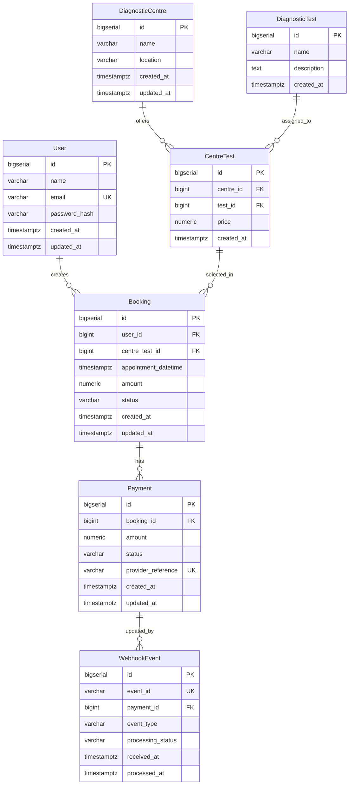

# EVE Healthcare — Diagnostic Test Booking & Payment Backend

Backend service for diagnostic test bookings, pricing catalogues, and simulated payment processing with database-level webhook idempotency, built with **Java 21**, **Spring Boot 3.3**, and **PostgreSQL**.

---

## Table of Contents
1. [Overview](#overview)
2. [Tech Stack](#tech-stack)
3. [Architecture & Project Structure](#architecture--project-structure)
4. [Database Design & Relationships](#database-design--relationships)
5. [Booking & Payment State Lifecycle](#booking--payment-state-lifecycle)
6. [Webhook Idempotency & Concurrency](#webhook-idempotency--concurrency)
7. [Local Setup & Running](#local-setup--running)
8. [Running Tests](#running-tests)
9. [API Reference & Examples](#api-reference--examples)
10. [Key Design Decisions & Trade-Offs](#key-design-decisions--trade-offs)
11. [Assumptions](#assumptions)
12. [What I Would Improve With More Time](#what-i-would-improve-with-more-time)

---

## Overview
This service provides APIs for:
- User signup and login with secure BCrypt password hashing and JWT access tokens.
- Diagnostic centres catalogue with lab tests and centre-specific pricing.
- Booking diagnostic tests with appointment validation and price snapshotting.
- Simulated payment processing with row-level pessimistic locking to prevent double charges.
- Idempotent payment webhook processing that handles duplicate and out-of-order gateway callbacks safely.

---

## Tech Stack
- **Language**: Java 21 LTS
- **Framework**: Spring Boot 3.3.4 (Spring Web MVC, Spring Security 6, Spring Data JPA)
- **Database**: PostgreSQL 16 (production/docker), H2 (in-memory test profile)
- **Database Migrations**: Flyway (versioned SQL migrations)
- **Authentication**: JJWT 0.12.6 (HMAC-SHA256 stateless tokens)
- **Testing**: JUnit 5, Spring Boot Test, MockMvc, AssertJ
- **API Documentation**: SpringDoc OpenAPI 2.6 (Swagger UI at `/swagger-ui.html`)
- **Containers**: Docker & Docker Compose (multi-stage Alpine image)

---

## Architecture & Project Structure
The project follows a standard layered architecture with clear separation between HTTP controllers, DTOs, business services, and database persistence:

```
src/main/java/com/eve/healthcare/
├── EveHealthcareApplication.java          # Spring Boot main class
├── common/
│   ├── config/                            # SecurityConfig, OpenApiConfig
│   ├── exception/                         # GlobalExceptionHandler, Custom exceptions, ErrorResponse
│   └── security/                          # JwtService, JwtAuthenticationFilter, CustomUserDetails, SecurityUtils
├── domain/
│   ├── model/                             # Entities (User, Centre, Test, CentreTest, Booking, Payment, WebhookEvent)
│   ├── repository/                        # Spring Data Repositories (pessimistic lock, JOIN FETCH queries)
│   └── service/                           # AuthService, CentreService, BookingService, PaymentService, WebhookService
└── web/
    ├── controller/                        # REST Controllers (Auth, Centre, Test, Booking, Payment, Health)
    └── dto/                               # Request & Response DTOs with Bean Validation
```

- **Controllers**: Handle HTTP routing, input validation (`@Valid`), and status code mapping.
- **Services**: Manage transactions (`@Transactional`), business invariants, and entity lifecycles.
- **Repositories**: Encapsulate queries; explicit `JOIN FETCH` queries are used on aggregate lookups to prevent N+1 queries.
- **GlobalExceptionHandler**: Uniform error contract across the API (returns consistent JSON error bodies with appropriate HTTP status codes: 400, 401, 404, 409, 422).

---

## Database Design & Relationships



### Relational Highlights:
- **`CentreTest` Junction**: Diagnostic tests have different prices depending on the lab centre. A composite unique constraint `(centre_id, test_id)` ensures a centre cannot offer the same test multiple times with conflicting prices.
- **`Booking.amount`**: Stores a frozen price snapshot taken from `CentreTest.price` at the moment of reservation.
- **Exact Decimals**: All currency fields use `NUMERIC(10, 2)` (mapped to Java `BigDecimal`), avoiding floating-point precision issues.
- **Migrations**: Database schema (`V1__initial_schema.sql`) and initial seed data (`V2__seed_data.sql`) are version-controlled via Flyway.

---

## Booking & Payment State Lifecycle

```
                 ┌─────────────┐
                 │   PENDING   │
                 └──────┬──────┘
                        │
            ┌───────────┼───────────┐
            │           │           │
     Payment Success  Cancel  Payment Failure
            │           │           │
            ▼           ▼           ▼
      ┌───────────┐┌─────────┐┌───────────┐
      │ CONFIRMED ││CANCELLED││  FAILED   │
      └───────────┘└─────────┘└─────┬─────┘
       (Terminal)  (Terminal)       │ Retry Payment (Success)
                                    ▼
                              ┌───────────┐
                              │ CONFIRMED │
                              └───────────┘
```

1. **PENDING**: Initial state upon booking creation.
2. **CONFIRMED**: Payment succeeded. This is a terminal state; confirmed bookings cannot be cancelled (`409 Conflict`).
3. **FAILED**: Payment failed. The user can retry payment for this booking.
4. **CANCELLED**: User cancelled a `PENDING` or `FAILED` booking. Terminal state; cancelled bookings cannot accept payments. Repeated cancellation requests return `200 OK` idempotently.

---

## Webhook Idempotency & Concurrency

Payment webhooks operate on at-least-once delivery. The service handles duplicate and out-of-order events as follows:

```
Webhook (event_id, payment_id, status)
                 │
                 ▼
      [Check existsByEventId]
        /                 \
  (Already exists)     (New Event)
       /                     \
      ▼                       ▼
  Return 200 OK          Open Transaction
  {"status":"duplicate"}      │
                              ▼
                     [Check Payment State]
                      /                 \
            (Already SUCCESS)      (FAILED/Pending)
                   /                       \
                  ▼                         ▼
         Ignore downgrade           Upgrade to SUCCESS
         Save event: IGNORED        Confirm booking
         Return 200 OK              Save event: PROCESSED
                                    Return 200 OK
```

1. **Database-Level Deduplication**: `webhook_events.event_id` has a database `UNIQUE` constraint. If duplicate requests arrive concurrently, the second transaction catches `DataIntegrityViolationException` and safely returns `200 OK {"status": "duplicate"}`.
2. **Terminal Invariant (No Downgrade)**: If a payment is already `SUCCESS`, a late or delayed `FAILED` webhook event is recorded as `IGNORED` and will not downgrade the payment or booking.

---

## Local Setup & Running

### Option 1: Docker Compose (Quickest)
Starts both PostgreSQL 16 and the Spring Boot service with automated migrations and seed data:

```bash
# 1. Copy environment variables template
cp .env.example .env

# 2. Build and start containers
docker compose up --build
```
The API will be available at `http://localhost:8080`.
Swagger UI: `http://localhost:8080/swagger-ui.html`

---

### Option 2: Running Locally with Maven

**Prerequisites**:
- Java 21 installed (`java -version`)
- Maven 3.9+ installed (`mvn -version`)
- PostgreSQL running on port 5432 with a database named `eve_healthcare`

```bash
# 1. Configure .env with your local DB credentials
# DATABASE_URL=jdbc:postgresql://localhost:5432/eve_healthcare
# DATABASE_USERNAME=postgres
# DATABASE_PASSWORD=postgres

# 2. Run the application (Flyway runs migrations automatically)
mvn spring-boot:run
```

Verify the service is running:
```bash
curl http://localhost:8080/health
# Response: {"status":"healthy"}
```

---

## Running Tests

The test suite runs against an isolated, in-memory H2 database in PostgreSQL compatibility mode. No external database or Docker setup is required to run tests.

```bash
mvn test
```

### Test Suite (42 Passing Tests):
- `AuthControllerTest` (10 tests): Signup, login, password validation, duplicate email (409), token expiration, malformed token, and unauthenticated access.
- `CentreControllerTest` (11 tests): Centre catalogue listing, test details, centre-specific price verification, centre creation, test creation, offering linking, duplicate offering prevention (409), and pagination.
- `BookingControllerTest` (10 tests): Booking creation, price snapshot integrity, past appointment rejection (422), user isolation (404 on cross-user access), cancellation invariants, and pagination.
- `PaymentControllerTest` (5 tests): Simulated payment success, payment failure, retry after failure, double-payment prevention (409), and cross-user payment blocking.
- `WebhookControllerTest` (6 tests): Duplicate event idempotency, status upgrade from FAILED to SUCCESS, no-downgrade policy, invalid status validation, and multi-threaded concurrent duplicate delivery.

---

## API Reference & Examples

### 1. Authentication

#### Register User
```bash
curl -X POST http://localhost:8080/auth/signup/ \
  -H "Content-Type: application/json" \
  -d '{
    "name": "Priyansh",
    "email": "priyansh@example.com",
    "password": "securepassword123"
  }'
```
Response (`201 Created`):
```json
{
  "user": {
    "id": 1,
    "name": "Priyansh",
    "email": "priyansh@example.com",
    "created_at": "2026-09-29T19:30:00Z"
  },
  "access_token": "eyJhbGciOiJIUzI1NiJ9...",
  "token_type": "bearer"
}
```

#### Login
```bash
curl -X POST http://localhost:8080/auth/login/ \
  -H "Content-Type: application/json" \
  -d '{
    "email": "priyansh@example.com",
    "password": "securepassword123"
  }'
```

---

### 2. Diagnostic Centres & Tests

#### List Centres (with optional pagination)
```bash
curl http://localhost:8080/centres/?page=0&size=10
```

#### Get Centre Details with Test Offerings & Prices
```bash
curl http://localhost:8080/centres/1/
```
Response (`200 OK`):
```json
{
  "id": 1,
  "name": "HealthFirst Diagnostics",
  "location": "Mumbai, Maharashtra",
  "tests": [
    {
      "id": 1,
      "test_id": 1,
      "test_name": "Complete Blood Count (CBC)",
      "price": 500.00
    },
    {
      "id": 2,
      "test_id": 2,
      "test_name": "Lipid Profile",
      "price": 800.00
    }
  ]
}
```

#### Create Centre (Management)
```bash
curl -X POST http://localhost:8080/centres/ \
  -H "Authorization: Bearer <TOKEN>" \
  -H "Content-Type: application/json" \
  -d '{
    "name": "Apex Diagnostics",
    "location": "Hyderabad, Telangana"
  }'
```

#### Add Test to Centre with Custom Price (Management)
```bash
curl -X POST http://localhost:8080/centres/1/tests/ \
  -H "Authorization: Bearer <TOKEN>" \
  -H "Content-Type: application/json" \
  -d '{
    "test_id": 5,
    "price": 850.00
  }'
```

---

### 3. Bookings

#### Create a Booking
```bash
curl -X POST http://localhost:8080/bookings/ \
  -H "Authorization: Bearer <TOKEN>" \
  -H "Content-Type: application/json" \
  -d '{
    "centre_id": 1,
    "test_id": 1,
    "appointment_datetime": "2026-10-15T10:30:00+05:30"
  }'
```
Response (`201 Created`):
```json
{
  "id": 101,
  "user_id": 1,
  "centre_test_id": 1,
  "centre_name": "HealthFirst Diagnostics",
  "test_name": "Complete Blood Count (CBC)",
  "appointment_datetime": "2026-10-15T05:00:00Z",
  "amount": 500.00,
  "status": "PENDING"
}
```

#### List My Bookings
```bash
curl http://localhost:8080/bookings/?page=0&size=10 \
  -H "Authorization: Bearer <TOKEN>"
```

#### Cancel Booking
```bash
curl -X POST http://localhost:8080/bookings/101/cancel/ \
  -H "Authorization: Bearer <TOKEN>"
```

---

### 4. Payments & Webhooks

#### Initiate Simulated Payment
```bash
curl -X POST http://localhost:8080/payments/ \
  -H "Authorization: Bearer <TOKEN>" \
  -H "Content-Type: application/json" \
  -d '{
    "booking_id": 101
  }'
```
Response (`201 Created`):
```json
{
  "id": 501,
  "booking_id": 101,
  "amount": 500.00,
  "status": "SUCCESS",
  "provider_reference": "pay_3a7b9c1d8e2f0a4b"
}
```

#### Gateway Webhook (Simulated Callback)
```bash
curl -X POST http://localhost:8080/payments/webhook/ \
  -H "Content-Type: application/json" \
  -d '{
    "event_id": "evt_998877",
    "payment_id": 501,
    "status": "SUCCESS"
  }'
```
Response (`200 OK`):
```json
{
  "event_id": "evt_998877",
  "status": "processed",
  "message": "Payment updated to SUCCESS, booking confirmed"
}
```
If resent with the same `event_id`:
```json
{
  "event_id": "evt_998877",
  "status": "duplicate",
  "message": "Event already processed"
}
```

---

## Key Design Decisions & Trade-Offs

### 1. `CentreTest` as an Explicit Entity
- **Rationale**: A test can be offered by multiple centres, and each centre sets its own price. Using an explicit junction entity with a composite unique constraint `(centre_id, test_id)` provides clean normalization and avoids duplicating test definitions across centres.
- **Trade-Off**: Requires joining through `CentreTest` when querying bookings, but this is handled efficiently with JPQL `JOIN FETCH` queries to avoid N+1 overhead.

### 2. Price Snapshotting in `Booking.amount`
- **Rationale**: Storing the price directly on the booking at creation time creates an immutable financial contract. If a centre changes its price later, past bookings and completed transactions remain unaffected.
- **Security**: The price is determined on the server side from the database; client requests never pass price parameters.

### 3. Pessimistic Row Locking on Payment Creation
- **Rationale**: When a user submits a payment, `BookingRepository.findByIdForUpdate` issues a `SELECT ... FOR UPDATE`. This serializes concurrent requests for the same booking at the database level, preventing double-payment race conditions.
- **Trade-Off**: Acquires a short row lock during the payment transaction, which is preferred for financial integrity over optimistic locking retries.

### 4. Database-Enforced Webhook Idempotency
- **Rationale**: Webhook deduplication relies on a unique index on `webhook_events.event_id` rather than in-memory caches. If two identical webhook requests arrive concurrently, the second transaction catches `DataIntegrityViolationException` and safely returns `200 OK {"status": "duplicate"}`.

### 5. Privacy Policy: 404 vs 403 on Cross-User Resources
- **Rationale**: When a user attempts to access or cancel a booking that belongs to someone else, the API returns `404 Not Found` rather than `403 Forbidden` to prevent booking ID enumeration.

---

## Assumptions
1. **Payment Simulation**: External payment gateways are simulated. The outcome is deterministic and configurable via the `PAYMENT_SIMULATE_SUCCESS` environment variable (`true` for always success, `false` for failure).
2. **Webhook Authentication**: In production, webhooks would verify an HMAC signature header (e.g., `Stripe-Signature`). For this assignment, the endpoint is open to accept simulated gateway payloads.
3. **Management Permissions**: Write operations on centres and tests (`POST /centres/`, `POST /tests/`) require a valid JWT token. In a full system, this would be tied to an `ADMIN` role.

---

## What I Would Improve With More Time
1. **Transactional Outbox Pattern**: Publish booking confirmation events via an outbox table and message broker (Kafka/RabbitMQ) to decouple email, SMS, and invoicing services.
2. **Rate Limiting**: Add token-bucket rate limiting (e.g., Bucket4j or Redis) on login and payment initiation endpoints to mitigate brute force and rapid retry attempts.
3. **Webhook HMAC Signature Verification**: Verify cryptographic HMAC-SHA256 signatures against a shared secret to ensure webhook payloads originate strictly from the verified gateway.
4. **Audit Logging (Envers)**: Implement Hibernate Envers (`@Audited`) for automated historical auditing of status transitions and cancellations over time.
